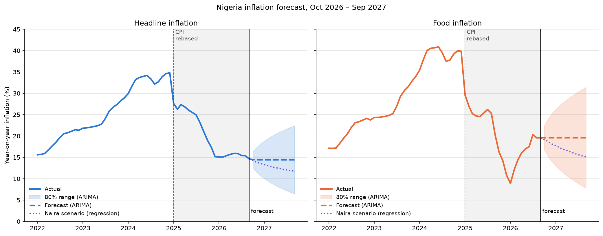
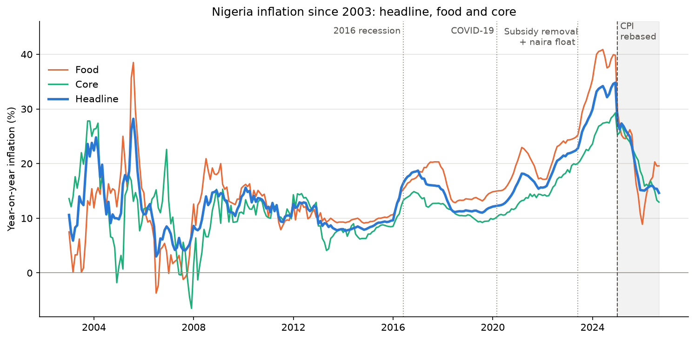
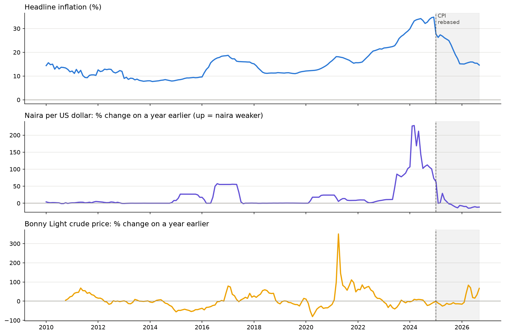
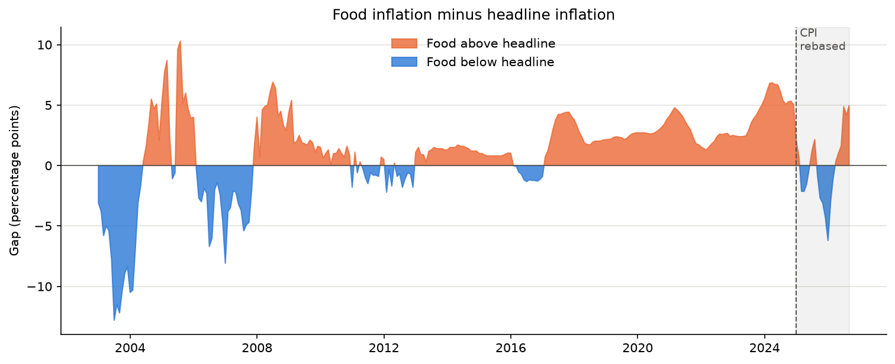
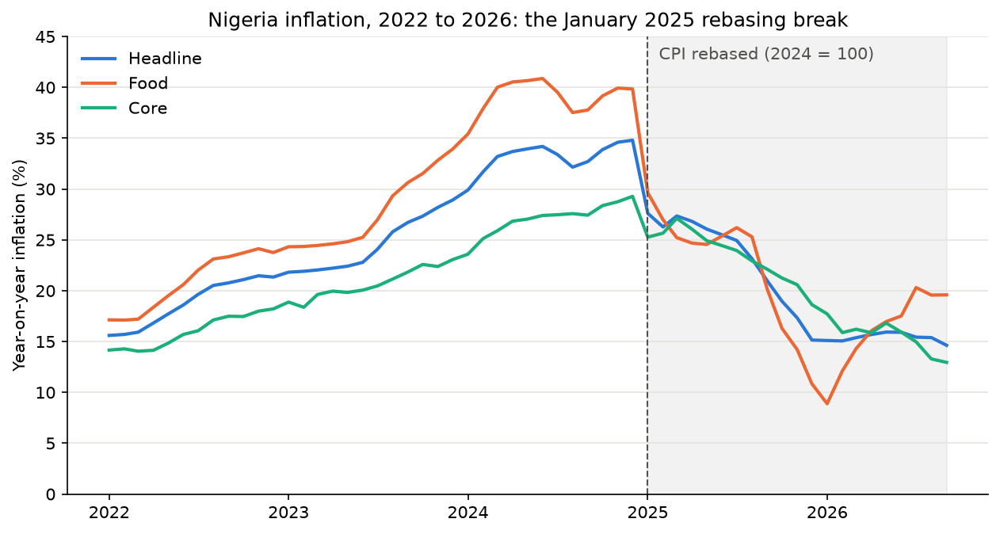
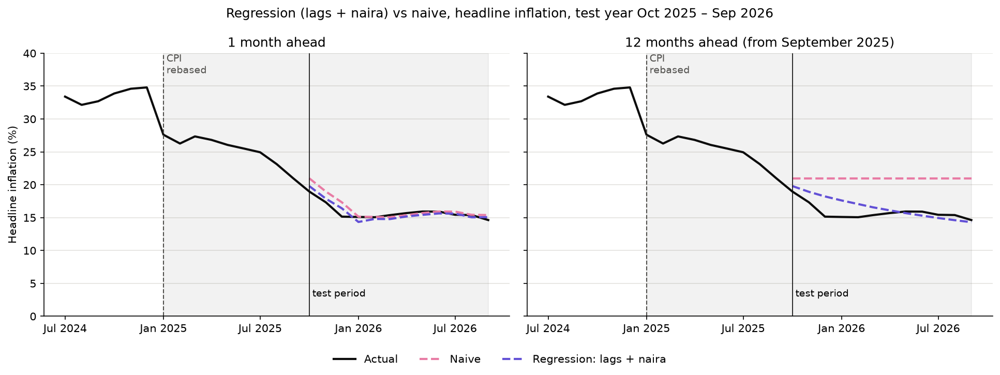
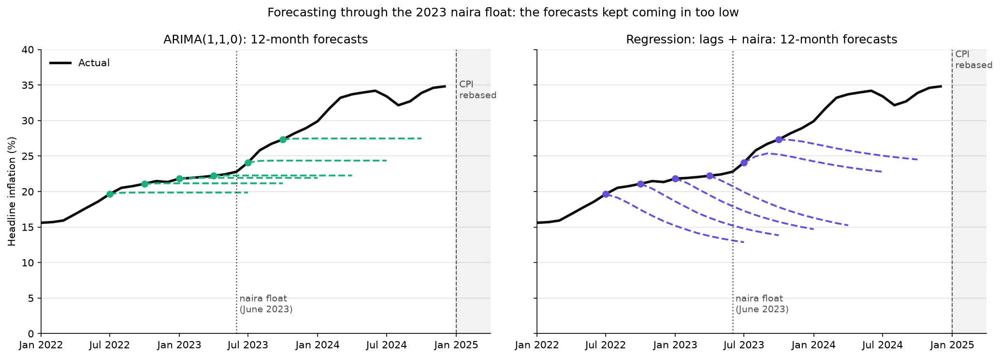

# Where is Nigeria's inflation heading?

In 2024, prices in Nigeria were rising faster than at any time in over twenty years. By December, things cost almost 35% more than they had a year earlier. For food, it was closer to 40%. Families, traders and small businesses had to set prices, ask for raises and decide what to save without knowing what the naira in their pocket would be worth a few months later.

Since then, inflation has come down a long way, to about 14.6% in September 2026. So the question everyone is asking is simple: **will it keep falling, level off, or turn back up?**

This project tries to answer that question honestly, using 23 years of official data. It looks back at what has driven inflation in the past, tests several ways of forecasting it, and ends with a forecast for the next twelve months, together with an honest range of how wrong that forecast could be.



## The short answer

The most likely path is that headline inflation **levels off at around 14 to 15%** over the next year. It could keep falling towards 12%, but probably only if the naira stays as strong as it has been in 2026. A turn back up is also quite possible. The realistic range by September 2027 runs from about 7% to about 22%.

**Food is the bigger worry.** Food inflation dropped to under 9% in January 2026, but it has been climbing ever since and stood at 19.6% in September. It is now about 5 points above overall inflation, and if that keeps up, it could drag the headline figure back up with it.

## The story in the data

### Inflation in Nigeria comes in waves

Looking back to 2003, inflation has not moved smoothly. It comes in waves, and each of the last three waves peaked higher than the one before.

- **2016:** oil prices crashed and the naira was devalued. Inflation climbed from under 10% to almost 19%.
- **2020 to 2021:** the COVID-19 shock pushed it to about 18% again.
- **2023 to 2024:** the end of the fuel subsidy and the floating of the naira in mid-2023 set off the biggest wave of all. Inflation peaked at 34.8% in December 2024.



### Behind almost every wave: the naira

The clearest pattern in the data is the link between inflation and the naira. When the naira loses value against the dollar, imported goods, fuel and anything that relies on them become more expensive. Within a few months, that shows up in prices across the economy.

Each of the big inflation waves since 2016 started soon after a sharp fall in the naira. The link is strongest about one month later, and it is still strong three months later. Crude oil prices, by contrast, showed almost no link with inflation. That is probably because petrol prices were held down by the fuel subsidy for most of these years. The subsidy ended in 2023, so oil may matter more from now on.



### Food hurts most, and it is rising again

Food prices usually rise faster than prices in general. That gap widens during hard times, and it hits poorer households hardest, because food takes up more of their budget. After a brief period in 2025 when food inflation fell below the overall rate, it has turned back up. In September 2026, food inflation was nearly 5 points above headline inflation, the same kind of gap seen during the 2023 to 2024 crisis.



### A change in the measuring tape

In January 2025, the National Bureau of Statistics (NBS) updated the way it measures inflation. It switched to a new, more up-to-date basket of goods that people actually buy today, with less weight on food. Overnight, the inflation rate dropped from 34.8% to about 27.6%. Most of that drop came from the new way of measuring, not from prices suddenly calming down.

This matters for any forecast. A model trained on the old numbers would see that drop as a sudden, real collapse in inflation, so the project marks the change on every chart and tests different ways of handling it.



## Can we see the future?

To test a forecast fairly, you have to hide the answers from it. So the project held back the most recent twelve months (October 2025 to September 2026), built each forecasting method using only the years before that, and then checked how close each one came.

Every method was compared against the simplest possible rule: **"next month will be the same as this month."** It sounds too simple to be useful, but inflation usually moves slowly, so it is surprisingly hard to beat.

Several approaches were tried, from simple averages to statistical models that learn from the past and a model that also takes the naira into account. The naira-based model looked brilliant on the hidden year: it correctly forecast inflation sliding from about 20% towards 15%, while the simple rule stayed stuck at 20%.



But one good year can be luck. So the project ran the same test again and again, from 56 different starting points between 2010 and 2023. Over all those years, **the naira-based model was usually worse than the simple rule**. It did well only when the naira kept moving in the same direction, and badly when the naira changed course. In the hidden year, the naira happened to stay strong, so the model looked better than it really is.

The model that held up best over the long run was a standard statistical model called ARIMA. It was about as good as the simple rule on average, and it rarely did much worse. Its other advantage is that it gives a range as well as a single number, and that range is what the final forecast is built on.

The toughest test was the floating of the naira in June 2023, the biggest shock in the data. Starting a forecast from every month between July 2022 and December 2023 showed that no model saw it coming. Almost every forecast ended up too low, often by 4 to 8 points. The naira-based model did worst of all before the float, because the official exchange rate had barely moved and gave it no warning. A model can only react to a devaluation after it has happened.



**The honest conclusion:** a year ahead, nothing tested here can reliably tell you which direction inflation will move. The naira really does drive inflation, but forecasting inflation a year ahead means first guessing where the naira will go, and that is the hard part. That is why the forecast comes with a wide range, and why the range matters more than the single number in the middle.

## The forecast

| | March 2027 | September 2027 |
|---|---|---|
| **Headline inflation** | about 14.4% (likely range 8.9% to 19.9%) | about 14.4% (likely range 6.5% to 22.4%) |
| If the naira stays strong | about 12.8% | about 11.8% |
| **Food inflation** | about 19.6% (likely range 11.4% to 27.8%) | about 19.6% (likely range 7.8% to 31.4%) |
| If the naira stays strong | about 16.9% | about 15.1% |

"Likely range" means the forecast model expects the actual figure to land inside it about 8 times out of 10. In testing, it landed inside a little less often than that, so treat the range as a minimum, not a guarantee.

## What could change the picture

A forecast built on the past assumes the future will behave like the past. These are the events most likely to prove it wrong:

- **The naira.** It is the single biggest driver. Right now it is about 11% stronger than a year ago, which is helping keep inflation down. If it weakens again, inflation would likely rise within a few months.
- **Fuel prices.** Petrol is no longer subsidised, so world oil prices now reach Nigerian pumps, and through them the cost of transport and food. In September 2026, crude oil cost about 67% more than a year earlier.
- **Harvests and food supply.** Food inflation is already rising. A poor harvest, flooding, insecurity in farming areas or the lean months before harvest could push it higher. A good harvest would help.
- **Interest rates.** If the Central Bank of Nigeria cuts interest rates as inflation falls, cheaper borrowing could boost spending and weaken the naira. This project's models do not include interest rates.
- **Elections.** General elections are due in early 2027, and extra spending around elections can add to price pressures.
- **Revisions to the numbers.** The official figures for 2025 were revised by about 3 points after they were first published (see below). Future revisions could change the picture without any change in actual prices.

## About the data

All the data comes from the Central Bank of Nigeria (CBN) website:

- **Monthly inflation** (overall, food, and "core" inflation, which leaves out farm produce and energy), from January 2003 to September 2026
- **Daily crude oil prices** (Bonny Light, Nigeria's main export blend), from October 2009
- **Daily official exchange rates** for the naira against the US dollar, from December 2001

The project downloads these from the data feeds that sit behind the CBN's website. **These feeds are not an official, documented service.** The CBN could change or remove them at any time. To protect against that, the project saves a copy of the data (`data/nigeria_macro.csv`) every time it runs, and uses that copy if the download fails.

Things worth knowing about the data:

- **The 2025 figures were revised.** When the NBS switched to the new way of measuring inflation, it first published figures for 2025 that it later found to be about 3 points too low, and in January 2026 it published corrected figures. The CBN data contains the corrected figures. This means the 2025 numbers in this project will not match news headlines from that year. For example, January 2025 is 27.61% here, but was announced at the time as 24.48%. A spot check of eleven months against news reports of NBS announcements:

  | Month | First announced by NBS | In the CBN data (corrected) |
  |---|---|---|
  | December 2024 | 34.80% | 34.80% |
  | January 2025 | 24.48% | 27.61% |
  | May 2025 | 22.97% | 26.06% |
  | June 2025 | 22.22% | 26.06% (copy error, see below) |
  | July 2025 | 21.88% | 24.94% |
  | August 2025 | 20.12% | 23.14% |
  | September 2025 | 18.02% | 20.98% (matches the NBS corrected figure) |
  | October 2025 | 16.05% | 18.97% |
  | November 2025 | 14.45% | 17.33% (matches the NBS corrected figure) |
  | December 2025 | 15.15% | 15.15% |
  | September 2026 | 14.63% | 14.63% |

- **One month is a copy error.** In the CBN data, June 2025 is an exact copy of May 2025. The project replaces it with an estimate halfway between May and July.
- **Two months of oil prices are missing.** June and July 2019 are missing from the oil price data, and were filled in with a straight-line estimate. There is no oil price data at all before October 2009.
- **The early years are jumpy.** Figures from 2003 to 2008 swing a lot from month to month, and occasionally go negative for food and core inflation.

## Limits of this project

- **Only year-on-year figures were available.** Because each month is compared with the same month a year earlier, normal seasonal patterns (like festive-season price rises) mostly cancel out and could not be studied.
- **Very little data uses the new measuring method.** Only 21 months of figures use the new basket. The models learn mostly from the old one.
- **Important drivers are missing.** The models do not include interest rates, government spending, harvest data or the parallel-market exchange rate.
- **The range may be too narrow.** In testing, the actual figure fell outside the 80% range more often than it should have.

## How to run it yourself

You need Python (version 3.12 or newer; this project was built on 3.15) and VS Code or another tool that can open Jupyter notebooks.

1. Download the project:
   ```
   git clone https://github.com/Freedom15dev/nigeria-inflation-forecast.git
   cd nigeria-inflation-forecast
   ```
2. Create a virtual environment and install the packages:
   ```
   python -m venv .venv
   .venv\Scripts\activate          (on Windows)
   source .venv/bin/activate       (on Mac or Linux)
   pip install -r requirements.txt
   ```
3. Open `nigeria_inflation_forecast.ipynb`, choose the `.venv` environment as the kernel, and run all the cells. It downloads fresh data from the CBN (or uses the saved copy if it can't), and takes about a minute.

## What's in this project

- `nigeria_inflation_forecast.ipynb`: the full analysis, step by step, with a written finding after every result
- `data/nigeria_macro.csv`: the saved copy of the monthly data
- `images/`: the charts used in this README and more
- `requirements.txt`: the Python packages needed

Built with Python, using pandas, matplotlib, scikit-learn and statsmodels.
